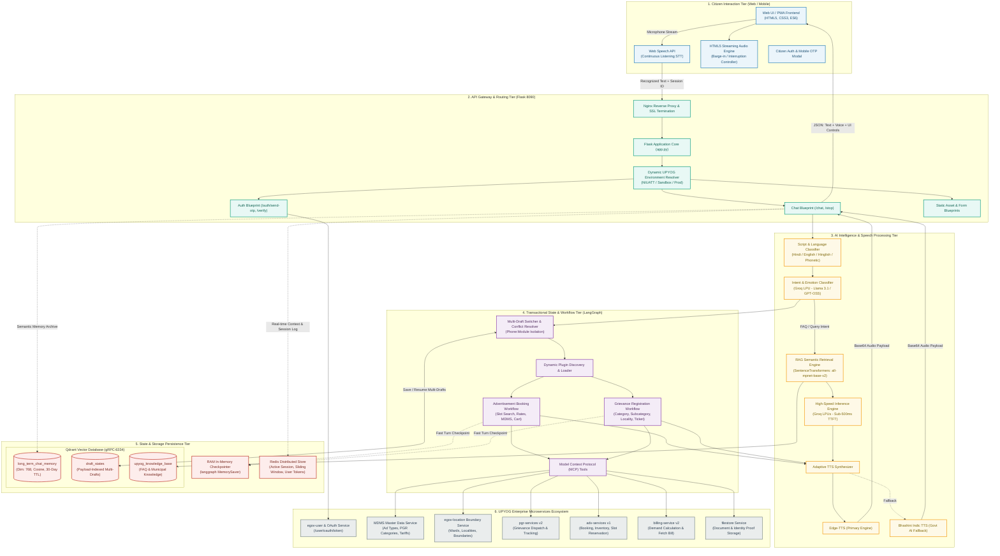
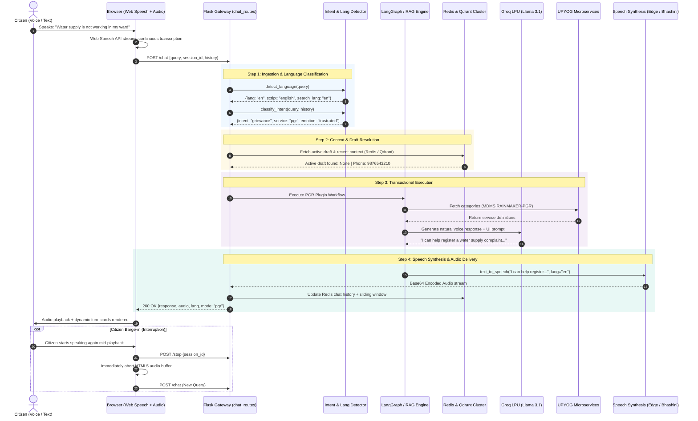
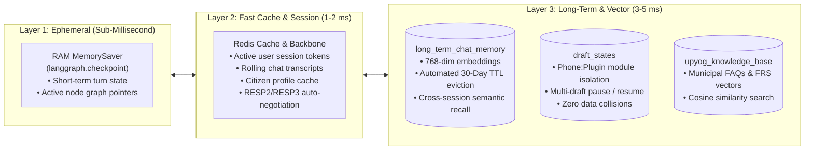

# UPYOG Voice Assistant (v2) — System Architecture Blueprint

## Executive Overview
The **UPYOG Voice Assistant (v2)** is an enterprise conversational AI platform that enables citizens to interact with municipal public services via natural, continuous bilingual voice (Hindi, English, Hinglish). 

It connects citizen voice interactions directly to the **National Urban Digital Mission (NUDM / UPYOG)** microservices infrastructure, handling citizen service discovery, grievance redressing (PGR), dynamic slot-booking for civic advertisements, document processing, and multi-draft state recovery.

---

## 1. System Master Architecture Diagram (Multi-Tier)

This diagram illustrates the comprehensive architecture across all tiers: Client Interface, API Gateway & Orchestration, Intelligence & Workflow, Storage & Memory, and External Municipal Microservices.

---

## 2. End-to-End Real-Time Voice Processing Pipeline

This sequence diagram illustrates the lifecycle of a single conversational turn, highlighting the low-latency design and barge-in capability.

---

## 3. Multi-Tier State & Persistence Topology

A major architectural highlight of the v2 bot is the **3-layer memory hierarchy**, balancing millisecond latency with multi-week persistence:

---

## 4. Key Architectural Pillars for Presentation Slides

### Pillar 1: Voice-First, Telephone-Call Experience
- **Continuous Listening**: Eliminates "push-to-talk" friction using browser Web Speech API.
- **Full Barge-in (Interruption)**: Citizens can interrupt the bot at any time; playback halts instantly and the server resets state cleanly.
- **Sub-2s Turnaround**: Average response latency between 1.5s – 2.5s from end-of-utterance to audio playback.

### Pillar 2: Scalable State & Multi-Draft Engine
- **Module Isolation (`phone_number:plugin_name`)**: A citizen can simultaneously hold an Advertisement Booking draft and a Grievance filing draft without overwrite collisions.
- **Resilient Fallback**: Every storage layer features transparent in-memory fallbacks (e.g., Redis down -> in-memory hash store; Qdrant down -> embedded memory client).

### Pillar 3: Ultra-Fast Inference Stack
- **Groq LPUs**: Powered by `llama-3.1-8b-instant` and specialized models providing 500+ tokens/second.
- **Dual Vector Architecture**: FAISS for fast local similarity and Qdrant gRPC for distributed cluster deployments.

### Pillar 4: Linguistic Inclusivity & Code-Switching
- **Per-Turn Dynamic Detection**: Seamlessly handles Hindi in Devanagari script, pure English, and colloquial Roman Hindi (Hinglish).
- **Dual TTS Engine**: High-fidelity Microsoft Edge-TTS for primary synthesis with Govt AI4Bharat / Bhashini fallback for regional dialect accuracy.

### Pillar 5: Deep Municipal Integration
- **Direct UPYOG Core Connectivity**: Authenticates via OAuth 2.0, pulls live MDMS configurations, resolves hierarchical GIS boundary trees, and files real municipal tickets with instant SMS notifications.

---

## 5. Latency Budget Breakdown (Slide Graphic)

| Processing Phase | Component / Engine | Typical Duration | Optimization Strategy |
| :--- | :--- | :--- | :--- |
| **Speech-to-Text** | Web Speech API | ~200 – 400 ms | Local/Edge browser processing |
| **Language & Intent** | Rule-Regex + Groq 8B | ~150 – 250 ms | Fast 150-token classifier, regex pre-routing |
| **Context & Vector Search** | Qdrant gRPC / FAISS | ~5 – 30 ms | Pre-indexed 768-dim vectors, cosine metric |
| **Workflow / API Call** | LangGraph + UPYOG | ~200 – 450 ms | Async HTTP sessions, cached MDMS masters |
| **LLM Token Generation** | Groq LPU | ~300 – 500 ms | High-throughput LPU hardware, max 300 tokens |
| **Speech Synthesis (TTS)**| Edge-TTS / Bhashini | ~400 – 700 ms | Text pre-cleaning pipeline, async audio chunks |
| **Network Round-Trip** | Flask + Nginx (Gzip) | ~50 – 100 ms | Localized hosting, compressed JSON payload |
| **Total End-to-End** | Full System Turn | **~1.5 – 2.4 sec** | **World-class conversational voice standard** |
